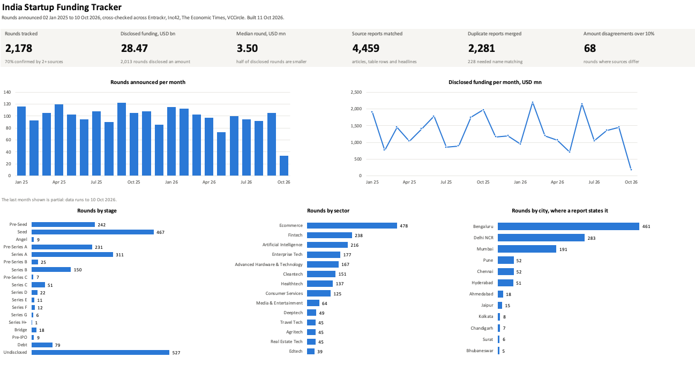

# India Startup Funding Tracker

Tracks the Indian startup funding rounds reported since 1 January 2025 by four news sources, merges the
reports that describe the same round, and flags the rounds where the sources disagree.

The cross-check is the point. One article can get a number wrong; four sources rarely get it wrong the
same way. So every round keeps each figure that was reported for it, a written rule decides which figure
is shown, and 18 automated checks decide which rounds a person should look at.

<!-- stats:start -->
_Numbers below are rewritten by every run. Last run: 19 October 2026._

| | |
| --- | ---: |
| Funding rounds tracked | **2,212** |
| Period covered | 02 Jan 2025 to 19 Oct 2026 |
| Source reports matched to a round | 4,531 |
| Duplicate reports merged | 2,319 |
| ...of which the company name differed between reports | 235 |
| Rounds confirmed by two or more sources | 1,539 (70%) |
| Disclosed funding | USD 29.49 bn across 2,046 rounds |
| Median disclosed round | USD 3.50 mn |
| Automated checks | 18 |
| Rounds where sources disagree on the amount by more than 10% | 68 |
| Rounds with a lakh/crore or million/billion mismatch | 1 |
| Funding headlines not yet matched to a round (review list) | 316 |
<!-- stats:end -->



*The Dashboard sheet of `reports/funding_tracker.xlsx` as Excel renders it (snapshot of 11 October 2026;
the workbook itself is rebuilt on every run).*

## How it works

| Step | What happens | Code |
| --- | --- | --- |
| 1. Collect | Reads each source's sitemaps for funding stories. Downloads Entrackr and ET articles and Inc42's weekly deal tables; reads VCCircle at headline level. | `sources.py`, `http.py` |
| 2. Parse | Pulls out company, amount (rupees or dollars; lakh, crore, million, billion), stage, investors and city. Sets aside stories that are not closed rounds. | `parse.py`, `extract.py` |
| 3. Match | Groups the reports of one round. Names are compared with rapidfuzz, so a typo or a dropped "Technologies" does not create a second round. | `match.py` |
| 4. Reconcile | Applies one written source-of-truth rule per field. | `reconcile.py` |
| 5. Check | Runs 18 checks. Every flag is listed with the figures behind it. | `checks.py` |
| 6. Report | Writes CSVs and an Excel workbook: dashboard, PivotTables by sector, stage and city, exceptions, rules. | `excel.py`, `report.py` |

`python -m funding_tracker update` runs all six. A GitHub Actions job runs it every Monday and commits
the result.

## Sources

| Source | What is read | Level |
| --- | --- | --- |
| [Entrackr](https://entrackr.com) | Every funding article: headline and opening paragraphs. Also the weekly report's deal count, used as a control total. | Detail |
| [Inc42](https://inc42.com) | The deal table in each weekly funding round-up. | Detail |
| [The Economic Times](https://economictimes.indiatimes.com/tech/funding) | Funding stories in the tech section: headline, date, byline and opening lines. Agency copy about rounds abroad is left out. | Detail |
| [VCCircle](https://www.vccircle.com) | Headlines, read from the article URL (articles are for subscribers). | Headline |

Only a detailed report can create a round. A VCCircle headline can confirm a round and add another
amount to compare, but a company name read from a URL is too rough to stand alone, so unmatched headlines
go to a review list (`data/processed/unmatched_headlines.csv`) instead of the round table.

The collector identifies itself, follows each site's robots.txt (including VCCircle's 20-second crawl
delay), waits between requests, and caches pages so nothing is downloaded twice. The repository stores
facts and links only. No article text is kept.

## The 18 checks

| ID | Check | Flags a round when |
| --- | --- | --- |
| C01 | Company name missing | the company is blank |
| C02 | Announcement date missing | there is no usable date |
| C03 | Amount undisclosed | no source reports an amount |
| C04 | Stage undisclosed | no source names the stage |
| C05 | No investor named | no source names an investor |
| C06 | Sector unclassified | there is no sector label and no keyword match |
| C07 | City unknown | no report says where the company is based |
| C08 | Duplicate report | one article URL appears twice in the source records |
| C09 | Possible duplicate round | the same company has another round within 45 days |
| C10 | Date outside tracking window | the date is before 1 Jan 2025 or in the future |
| C11 | Amount outlier for its stage | log10(amount) is beyond 1.5 x IQR for that stage |
| C12 | Implausible amount | the amount is below $0.01 Mn or above $2,000 Mn |
| C13 | INR/USD mismatch | a report's rupee and dollar figures imply a rate more than 10% off the reference rate |
| C14 | Lakh/crore or million/billion mismatch | two reports of the round differ by a factor of about 10, 100 or 1,000 |
| C15 | Amount disagreement | the highest and lowest reported amounts differ by more than 10% |
| C16 | Date disagreement | reports of the round are more than 7 days apart |
| C17 | Lead investor disagreement | two detailed sources each name a lead investor and have none in common |
| C18 | Stage disagreement | two detailed sources state different stages |

Nothing is corrected automatically. A flag puts the round on the Exceptions sheet with each source's own
figure, and the round carries the check IDs in its `flags` column until someone looks at it.

## Source of truth

Which source wins for each field is written down in [docs/SOURCE_OF_TRUTH.md](docs/SOURCE_OF_TRUTH.md)
and on the workbook's Source rules sheet. Both are generated from one list in `reconcile.py`, so the
document cannot drift from the code. In short:

- **Company**: the spelling most reports agree on.
- **Announced**: the earliest report.
- **Amount**: Entrackr, then Inc42, then ET, then VCCircle. Never an average.
- **USD**: as stated, or rupees converted at the ECB reference rate for the announcement date.
- **Stage, sector**: the Inc42 table first.
- **Investors**: everyone named by a detailed source, each listed once.
- **City**: only where a report states it.

## Outputs

| File | What it is |
| --- | --- |
| `reports/funding_tracker.xlsx` | The workbook: Dashboard, Rounds, three PivotTable sheets, Checks, Exceptions, Source rules, Reports, Coverage. |
| `reports/summary.md` | The numbers from the latest run. |
| `data/processed/rounds.csv` | One row per funding round. |
| `data/processed/reports_matched.csv` | Every report behind a round, with the amount exactly as that source gave it. |
| `data/processed/merge_log.csv` | Every duplicate report that was merged, and how the match was made. |
| `data/processed/exceptions.csv` | One row per flag raised by the checks. |
| `data/processed/checks_summary.csv` | The 18 checks with the number of rounds each one flagged. |
| `data/processed/weekly_coverage.csv` | Rounds tracked per week beside Entrackr's own weekly count. |
| `data/processed/unmatched_headlines.csv` | Funding headlines with no detailed report behind them yet (a review list). |
| `data/processed/not_closed_watchlist.csv` | Rounds reported as still under way ("in talks", "to raise"). Not counted, but worth watching. |
| `data/interim/source_records.csv` | Every candidate story that was read, including the ones left out and why. |
| `data/reference/` | USD/INR reference rates, city spellings, sector labels and keywords. |

Column definitions are in [docs/DATA_DICTIONARY.md](docs/DATA_DICTIONARY.md). How rounds are defined,
matched and converted is in [docs/METHODOLOGY.md](docs/METHODOLOGY.md).

## Run it

```bash
python -m venv .venv && source .venv/bin/activate
pip install -r requirements.txt
export PYTHONPATH=src

python -m funding_tracker update     # read the week's new reports, then rebuild everything
python -m funding_tracker build      # rebuild from the records already on file (no network)
pytest                               # run the tests
```

`backfill` re-reads everything since the start date (about 90 minutes, most of it polite waiting).
`reparse` re-runs the parsing rules on pages already downloaded.

## What the tracker does not know

- **City is partial.** It is filled only when a report says where the company is based. The rest are
  shown as Unknown rather than guessed.
- **VCCircle is headline-only.** It contributes a company, an amount and a date, not investors or
  stage. ET is partly behind a paywall, so only its headline and opening lines are read.
- **Amounts are as reported.** A round announced in tranches can appear as two rounds; check C09 lists
  those for review.
- **Rounds that are not closed are left out.** "In talks to raise" and "plans to raise" are not rounds.
  Neither are fund raises by investors, IPO-related deals, pure secondary sales or a parent funding its
  own subsidiary. `source_records.csv` records the reason for each one left out.
- **Rules, not a language model.** Parsing is regular expressions with tests. It is predictable and
  easy to audit, and it will misread an unusual sentence. The checks exist to catch that.

## Layout

```
src/funding_tracker/   the pipeline (one module per step)
tests/                 pytest suite; names in the fixtures are made up
data/reference/        lookup tables and exchange rates
data/interim/          one row per report read
data/processed/        one row per round, plus checks and logs
reports/               the Excel workbook and the run summary
docs/                  methodology, source-of-truth rules, data dictionary
.github/workflows/     tests on every push; the weekly update
```

## Sources and credit

All figures come from public reporting by Entrackr, Inc42, The Economic Times and VCCircle; every round
links back to the reports it was built from. This project is not affiliated with any of them. Exchange
rates are European Central Bank reference rates served by [Frankfurter](https://frankfurter.dev).
